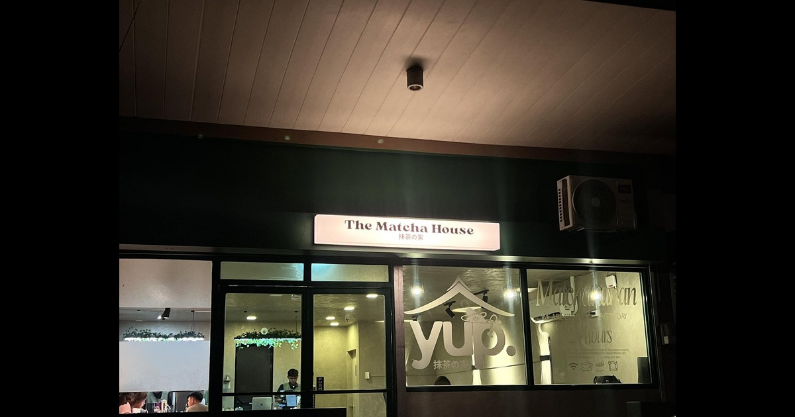

# The Matcha House

> Good things come in green.

A responsive, multi-page café website built with **HTML, CSS, vanilla JavaScript, and Vite** as a student front-end web development project. It demonstrates menu browsing, interactive product dialogs, a client-side shopping cart, membership registration, responsive navigation, SEO metadata, social link previews, and Progressive Web App (PWA) capabilities.

**Live Demo:** [thematchahouse.vercel.app](https://thematchahouse.vercel.app/)

[](https://vite.dev/)
[](https://developer.mozilla.org/en-US/docs/Web/JavaScript)
[](https://web.dev/learn/pwa/)
[](https://vercel.com/)

> [!IMPORTANT]
> **Educational Project Disclaimer**
>
> This is an independent student project created for academic and demonstration purposes. It is not the official website of The Matcha House and is not affiliated with, operated by, sponsored by, or endorsed by the business.
>
> Business names, branding, photographs, menu descriptions, prices, location information, and social media links are included for demonstration purposes and may not reflect current official information. Please consult the business's official channels for accurate details.
>
> The ordering interface and membership system are front-end demonstrations only. They do not submit real orders, process real payments, or manage actual user database memberships.

## Code Style

The project uses native HTML and CSS alongside vanilla JavaScript ES modules.

- Four-space indentation.
- No semicolons in JavaScript.
- Descriptive section comments using the `/* ---------- Section ---------- */` convention.
- Shared functionality is separated into reusable JavaScript modules.
- Menu content is maintained in a dedicated data module rather than hardcoded into individual product cards.

No dedicated linting or code-formatting tool is currently configured.

## Preview

**Live website:** [https://thematchahouse.vercel.app/](https://thematchahouse.vercel.app/)

The repository includes a dedicated Open Graph image used for social link previews.



## Tech / Framework Used

**Built with:**

- [HTML5](https://developer.mozilla.org/en-US/docs/Web/HTML) — page structure and semantic markup.
- [CSS3](https://developer.mozilla.org/en-US/docs/Web/CSS) — responsive layouts, custom styling, animations, and media queries.
- [Vanilla JavaScript](https://developer.mozilla.org/en-US/docs/Web/JavaScript) — application logic, event handling, and DOM manipulation.
- [Vite](https://vite.dev/) — development server, asset processing, and production builds.
- [vite-plugin-pwa](https://vite-pwa-org.netlify.app/) — PWA manifest and service-worker generation.
- [vite-plugin-qrcode](https://www.npmjs.com/package/vite-plugin-qrcode) — QR code generation for local development.
- [Google Fonts](https://fonts.google.com/) — DM Sans and Fraunces.
- [Vercel](https://vercel.com/) — website deployment and clean URL rewrites.

## Features

### Menu and Product Browsing

- Seven categories of drinks and food.
- Product images, descriptions, and prices.
- Interactive product details dialog.
- Size selection for products with multiple price options.
- Quantity controls and quick-add buttons.

### Shopping Cart & Member Discounts

- Client-side cart state shared across pages.
- Cart persistence through `sessionStorage`.
- Automatic 5% membership discount integration for registered members.
- Quantity adjustment and item removal.
- Pickup and delivery selection with automated delivery fee calculations.
- Demo checkout flow supporting Cash, GCash, and Maya payment methods with confirmation dialogs.

**Note:** The cart is entirely front-end functionality. Cart contents are stored in the current browser tab's session, and checkout is simulated.

### Membership Club

- Interactive member registration form.
- Automated generation of simulated Member IDs (`TMH-XXXXXX`).
- Local session storage of member data enabling instant perk redemption (e.g., automated 5% checkout discount).
- Confirmation modal with summary card.

### Responsive Interface

- Responsive header and mobile navigation menu.
- Collapsible menu-category sidebar on smaller screens.
- Active category scroll-spy highlighting.
- Native HTML `<dialog>` elements for modals (product details, checkout, payment, membership confirmation).
- Toast notifications for actionable feedback.
- Keyboard focus indicators and reduced-motion support.

### Location and Contact

- Café location information and embedded Google Maps iframe.
- Copy-address functionality with toast feedback.
- Real-time opening status display based on Philippine Time (PST / Asia/Manila).
- Contact information, feedback form, and social media links.

### Progressive Web App

- Web app manifest and installation icons (192x192, 512x512, maskable).
- Generated service worker with automatic-update configuration via `vite-plugin-pwa`.
- Configured asset precaching for offline resilience.

### SEO and Link Previews

- Page-specific titles and meta descriptions.
- Canonical URLs for public pages.
- Open Graph metadata and Twitter card configurations for social sharing.
- Structured `robots.txt` and `sitemap.xml`.

## Code Example

### Menu Data Structure

The menu is maintained as structured data in `src/data/menu.js`. Each product has an identifier, name, prices, and description.

For example:

```javascript
item(
    'mango-matcha-latte',
    'Mango Matcha Latte',
    sized(255, 295, 305),
    'A bright mango twist on a smooth iced matcha latte.'
)
```

The `sized()` helper creates the available price options. The menu page reads this data and generates the product cards and details dialogs dynamically.

Each item's ID must match its image filename, excluding the `.png` extension.

## Installation

### Prerequisites

- [Node.js](https://nodejs.org/) compatible with the installed Vite version (Node.js 20.19+ or 22.12+ for Vite 8).
- npm.
- Git.

### Clone the Repository

```bash
git clone https://github.com/adAstra144/the-matcha-house.git
cd the-matcha-house
```

### Install Dependencies

```bash
npm install
```

### Start the Development Server

```bash
npm run dev
```

Open the local URL printed in your terminal, typically:

```text
http://localhost:5173/
```

## Scripts

| Command | Description |
|---|---|
| `npm run dev` | Starts the Vite development server with hot reload. |
| `npm run build` | Creates an optimized production build in `dist/`. |
| `npm run preview` | Serves the production build locally for testing. |

To test the production build locally:

```bash
npm run build
npm run preview
```

## JavaScript Modules

### Cart Store — `src/cart.js`

| Export | Description |
|---|---|
| `getState()` | Returns the current cart state. |
| `getCount()` | Returns the total quantity of cart items. |
| `getSubtotal()` | Calculates the item subtotal. |
| `getDiscount()` | Calculates the 5% membership discount (if applicable). |
| `getDeliveryFee()` | Returns the applicable delivery fee. |
| `getTotal()` | Calculates the final cart total (Subtotal - Discount + Delivery). |
| `hasMembership()` | Checks if a member session exists. |
| `add(item, quantity)` | Adds an item or increases its quantity. |
| `setQuantity(id, size, quantity)` | Updates an item's quantity. |
| `remove(id, size)` | Removes a specific item and size. |
| `setDelivery(delivery)` | Sets the pickup or delivery preference. |
| `clear()` | Empties the cart and resets delivery selection. |
| `subscribe(fn)` | Registers a callback for cart updates and returns an unsubscribe function. |
| `reload()` | Reloads cart data from session storage and notifies subscribers. |

### Toast Notifications — `src/toast.js`

Import and call `showToast(message)` to display a temporary notification.

```javascript
import { showToast } from './toast.js'

showToast('Added to cart')
```

### Menu Data — `src/data/menu.js`

Exports the `categories` array containing all drink and food series with their respective item definitions.

## Routes

| URL | HTML source | Purpose |
|---|---|---|
| `/` | `index.html` | Homepage and café introduction. |
| `/menu` | `sections/menu.html` | Menu browsing and product interactions. |
| `/cart` | `sections/cart.html` | Demo cart, discount calculation, and simulated checkout. |
| `/location` | `sections/location.html` | Location information, map, and store status. |
| `/contact` | `sections/contact.html` | Contact details and feedback form. |
| `/membership` | `sections/membership.html` | Membership application and reward perks enrollment. |

Clean routes are configured through `vercel.json` for deployment and `vite.config.js` for development and preview servers.

## Project Structure

```text
.
├── index.html
├── sections/
│   ├── cart.html
│   ├── contact.html
│   ├── location.html
│   ├── membership.html
│   └── menu.html
├── public/
│   ├── videos/
│   ├── favicon.png
│   ├── og-matcha-house.jpg
│   ├── pwa-192x192.png
│   ├── pwa-512x512.png
│   ├── pwa-maskable-512x512.png
│   ├── robots.txt
│   └── sitemap.xml
├── src/
│   ├── assets/
│   │   ├── icons/
│   │   └── items/
│   ├── data/
│   │   └── menu.js
│   ├── cart-page.js
│   ├── cart.js
│   ├── location.js
│   ├── membership.js
│   ├── menu.js
│   ├── script.js
│   ├── toast.js
│   ├── reset.css
│   ├── style.css
│   ├── index.css
│   ├── menu.css
│   ├── cart.css
│   ├── location.css
│   ├── membership.css
│   └── contact.css
├── package.json
├── vercel.json
├── vite.config.js
└── README.md
```

## Deployment

The project is configured for Vercel deployment.

1. Import the repository into [Vercel](https://vercel.com/).
2. Select the Vite framework preset.
3. Build Command: `npm run build`.
4. Output Directory: `dist`.
5. Deploy.

The `vercel.json` file handles route rewrites to ensure clean URLs work without requiring `.html` extensions.

## Credits

**Developer:** [AdAstra144](https://github.com/adAstra144) | Basti

**Development assistance:** ChatGPT, Claude, and Google AI Mode.

**Technologies and services:** Vite, Vite PWA, Vite QR Code Plugin, Google Fonts, Google Maps, Vercel, and Bootstrap Icons.