# The Matcha House — Project Documentation

**A responsive café website with online ordering and membership**

*Final Project Documentation · Web Development*

| Project Details | Information |
|---|---|
| College | College of Computer Science |
| Course and Section | BSCS-1 |
| Instructor | Sir Gerald Anthony C. Villa |
| Submitted by | Sebastian Daniel Z. Sabio |
| Date of Submission | [Insert date] |
| Published Website | [thematchahouse.vercel.app](https://thematchahouse.vercel.app/) |


## Table of Contents

- [1. Introduction](#1-introduction)
- [2. Objectives](#2-objectives)
- [3. Features](#3-features)
- [4. Code Organization and Project Structure](#4-code-organization-and-project-structure)

---

## 1. Introduction

### 1.1 Background

The Matcha House is a café in Lucena City, located on Ruby Street, Pleasantville Bridge. It serves matcha drinks, signature coffee, cloud-topped specialty drinks, Vietnamese-inspired beverages, pasta, and comfort food, and it is open 24 hours a day, every day. Customers come at any hour to study, work, meet friends, or simply relax.

This website is an independent student project built for the Web Development course. It is not the official website of the business; the business name, branding, photographs, menu, and prices are used for academic demonstration only.

### 1.2 Problem and Real-World Scenario

A small café usually shares its information through scattered social media posts and map listings. A customer who wants to know what is on the menu, how much a drink costs, where the shop is, or whether it is open has to search several places. Orders and loyalty perks are handled in person, so customers cannot plan an order or see their benefits ahead of time.

This project addresses that scenario by putting everything in one website: a browsable menu with prices, a working order cart, a location page with a map, contact channels, and a membership sign-up that rewards returning customers.

### 1.3 Purpose

The purpose of the project is to design and develop a complete, responsive, multi-page website using HTML, CSS, and vanilla JavaScript that lets customers explore the café, build an order, and register as a member, while demonstrating the core front-end skills taught in the course: semantic HTML, responsive CSS, DOM manipulation, event handling, data-driven rendering, form validation, and publishing a site online.

### 1.4 Target Users

- **Customers and walk-in guests** who want to see the menu, prices, and directions before visiting.

- **Students and remote workers** who use the café at all hours and may order ahead for pickup or delivery.

- **Returning customers** who want to join the membership club and receive a discount.

- **The café owner or staff**, who benefit from a single online presence that is easy to share through links and social media previews.

### 1.5 Scope and Limitations

**Scope.** The website has six pages: Home, Menu, Location, Contact, Membership, and Cart. It includes a data-driven menu of 58 items in 7 categories, a client-side shopping cart, a simulated checkout, a membership application with an automatic 5% discount, an embedded map, social media links, search-engine metadata, and Progressive Web App (PWA) support. It is deployed on Vercel.

**Limitations.** The project is front-end only. There is no server or database. Checkout and payments are simulated (no real payment is processed), and membership data is stored only in the current browser tab's session storage. Cart contents also last only for the current browser tab session.

---

## 2. Objectives

### 2.1 General Objective

To develop a responsive, multi-page café website for The Matcha House that lets customers browse the menu, place a simulated order, find the shop, contact the café, and register for a membership using HTML, CSS, and JavaScript.

### 2.2 Specific Objectives

1. To build six linked pages (Home, Menu, Location, Contact, Membership, Cart) using semantic HTML5, with HTML, CSS, and JavaScript kept in separate, organized files.

2. To display all 58 menu items across 7 categories, with images, descriptions, sizes, and prices, generated from a single JavaScript data module instead of hard-coded cards.

3. To implement a shopping cart that allows adding items from the menu (by quick-add or from the item dialog), changing quantities from 1 to 99, removing items, choosing pickup or delivery (₱50 delivery fee), and keeping the cart while the user moves between pages.

4. To implement a membership application form that validates input, generates a member ID in the format TMH-XXXXXX, and automatically applies a 5% discount to the cart total.

5. To simulate checkout with Cash, GCash, and Maya payment options, a processing state, and an order confirmation dialog.

6. To make every page responsive, with layouts that adapt at 1200 px, 1023 px, 640 px, and 560 px and do not scroll sideways.

7. To help customers find the café through an embedded map, a directions link, a copy-address button, and a status line showing the current Philippine time.

8. To give users clear feedback and accessible controls through toast messages, hover and focus styles, ARIA labels, native dialogs, and reduced-motion support.

9. To publish the website online at [thematchahouse.vercel.app](https://thematchahouse.vercel.app/) with SEO metadata, social link previews, a sitemap, and an installable PWA manifest.

---

## 3. Features

Each feature below states what it does and how it is used. Screenshots should be inserted where marked and must match the working website.

### 3.1 Site-Wide Header and Navigation

**What it does.** Every page shares the same header with the brand logo, links to Home, Menu, Location, Contact, and Membership, and a cart button. On screens 1200 px wide or smaller, the links collapse into a burger menu that slides in from the left. The link of the current page is highlighted, and the cart button shows a badge with the number of items, which animates when an item is added.

**How it is used.** Click a link to go to a page. On a phone or tablet, tap the burger icon to open or close the menu. Tap the cart button to open the cart.


> *Figure 1. Desktop header with navigation links and cart badge.*


> *Figure 2. Mobile navigation menu.*

### 3.2 Home Page

**What it does.** The home page opens with a full-screen hero section that plays a looping background video (with an image fallback) and the tagline "Good things come in green." The video is loaded only after the page finishes loading, and it is skipped when the visitor prefers reduced motion or uses data saver. Below the hero are an About section ("Open all day, all night") with a pull quote, a status line showing the current Philippine time, a list of hours, seating, and offerings, three photo cards (Front, Lounge, Seats), and a Google Reviews widget. Arrow buttons scroll down to the About section and back to the top.

**How it is used.** Scroll or click the arrow to read more. Use the See the menu button to go to the menu, or Get directions to go to the Location page.

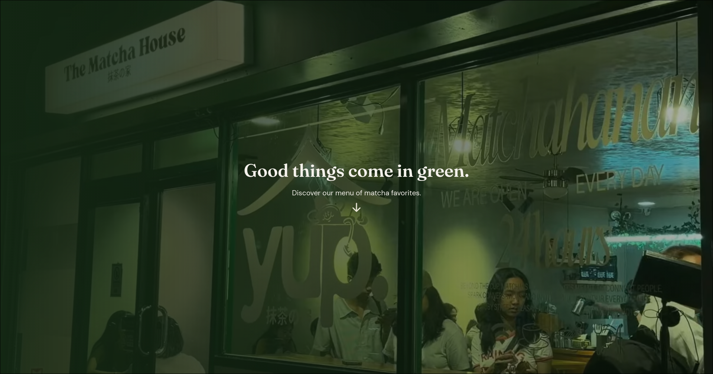

> *Figure 3. Home page hero section.*

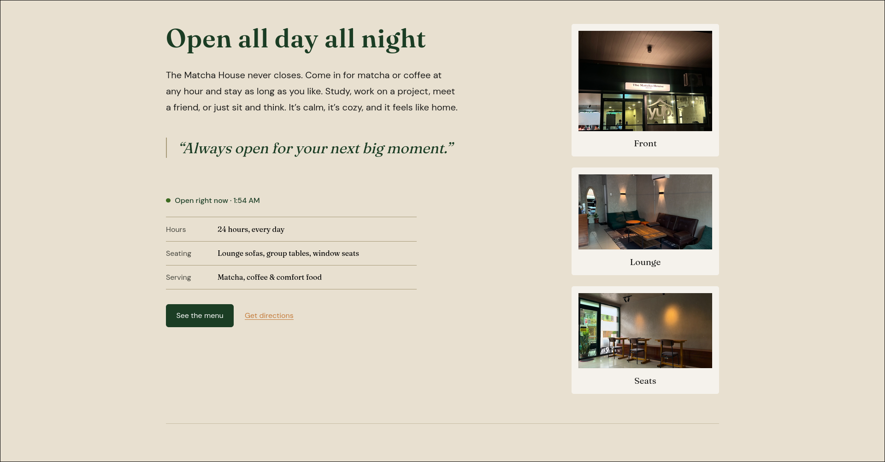

> *Figure 4. About section with visit information and photos.*

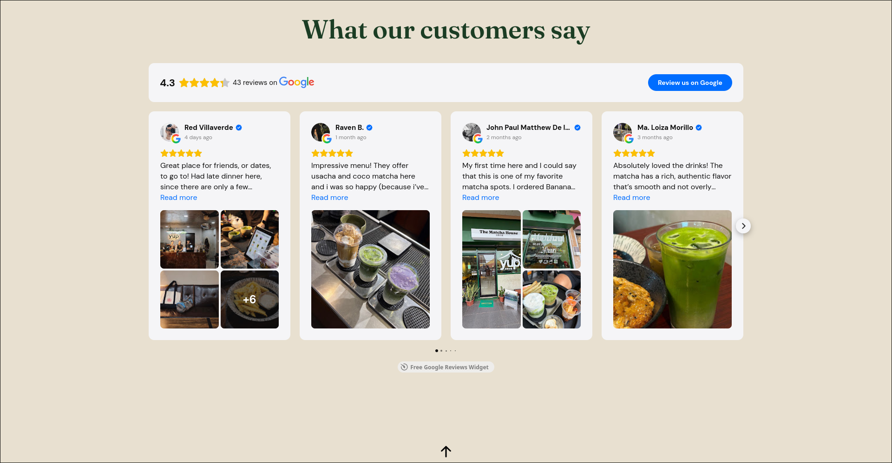

> *Figure 5. Customer reviews section.*

### 3.3 Menu Page

**What it does.** The menu is built by JavaScript from the data file `src/data/menu.js`. It shows 7 categories (Matcha Series Drinks, Signature Coffee Series, Signature Matcha Drinks, Cloud Series, Vietnam Series, Your Comfort on a Plate, and Pasta and Salad), each with item cards that have an image and a name. A sidebar lists the categories and highlights the one currently in view (scroll spy). On tablets and phones the sidebar becomes a drawer opened by the Categories button.

**How it is used.** Click a category in the sidebar to jump to it. Click an item card to open its details dialog.

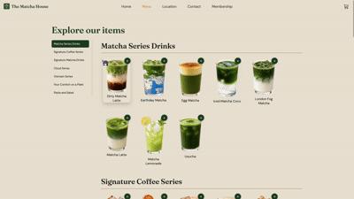

> *Figure 6. Menu page with category sidebar.*

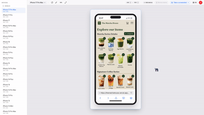

> *Figure 7. Category drawer on a mobile device.*

### 3.4 Item Details Dialog and Quick Add

**What it does.** The item dialog shows the item image, name, description, and prices. Items with several sizes (Regular, Grande, Venti) show a size picker with the price of each size; items with one price simply show it. The dialog has a quantity selector limited to 1–99 and an Add to Cart button. Each card also has a round + button that adds one item immediately using its first listed size. A toast message confirms every addition.

**How it is used.** Open an item, choose a size and quantity, then click Add to Cart. Or press + on a card for a one-click add. Close the dialog with the × button, by clicking outside it, or by pressing Escape.

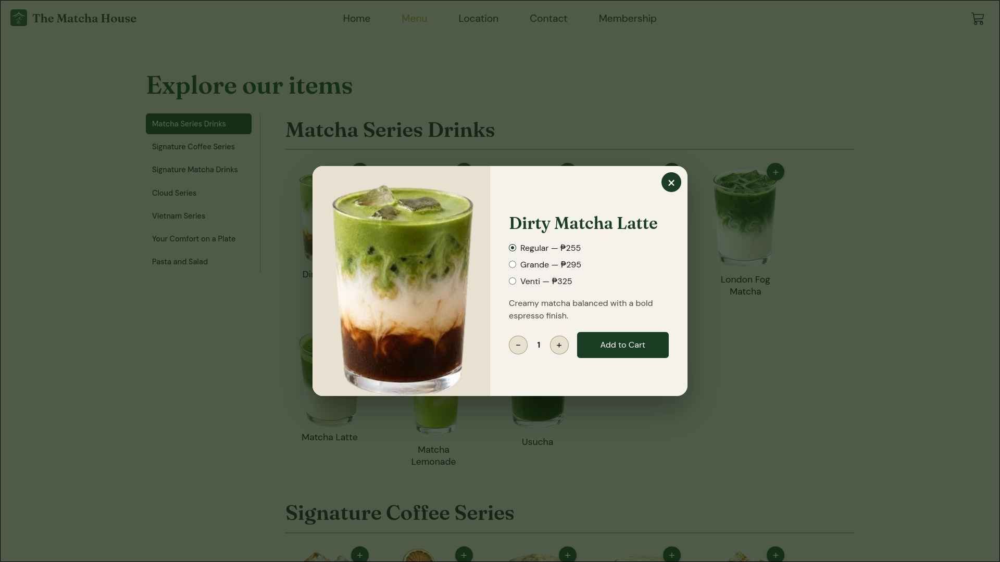

> *Figure 8. Item details dialog.*

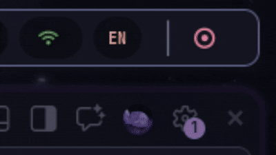

> *Figure 9. Toast confirmation after adding an item.*

### 3.5 Shopping Cart

**What it does.** The cart page lists every item with its picture, size, unit price, quantity controls, line total, and a remove button. The customer chooses Pickup or Delivery (+₱50). The totals show the subtotal, delivery fee, membership discount (only for members), and the final total. The cart is saved in `sessionStorage`, so it remains when moving between pages. An empty cart shows a message and a Browse Menu button.

**How it is used.** Use − and + to change quantity (reducing below 1 removes the item), the trash icon to remove it, and the radio buttons to choose the order type. Click Place Order to begin checkout.

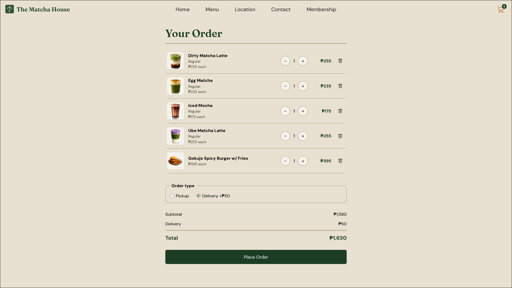

> *Figure 10. Cart page with order type and totals.*

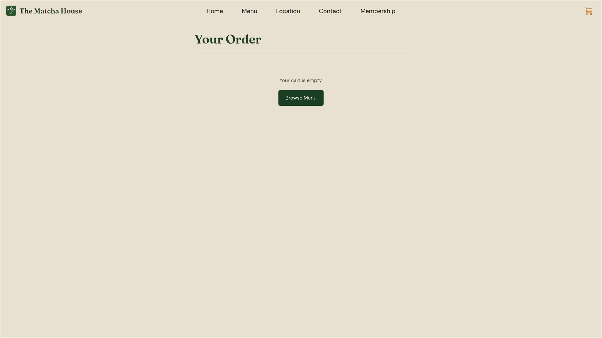

> *Figure 11. Empty cart state.*

### 3.6 Simulated Checkout

**What it does.** Place Order opens a payment dialog showing the order type and total, with three payment methods: Cash, GCash, and Maya. Submitting shows a Processing state for about 1.2 seconds, clears the cart, and opens an Order placed confirmation with the chosen payment method. A note in the dialog states that no real payment is processed.

**How it is used.** Select a payment method and click Pay. Click Back to menu on the confirmation.

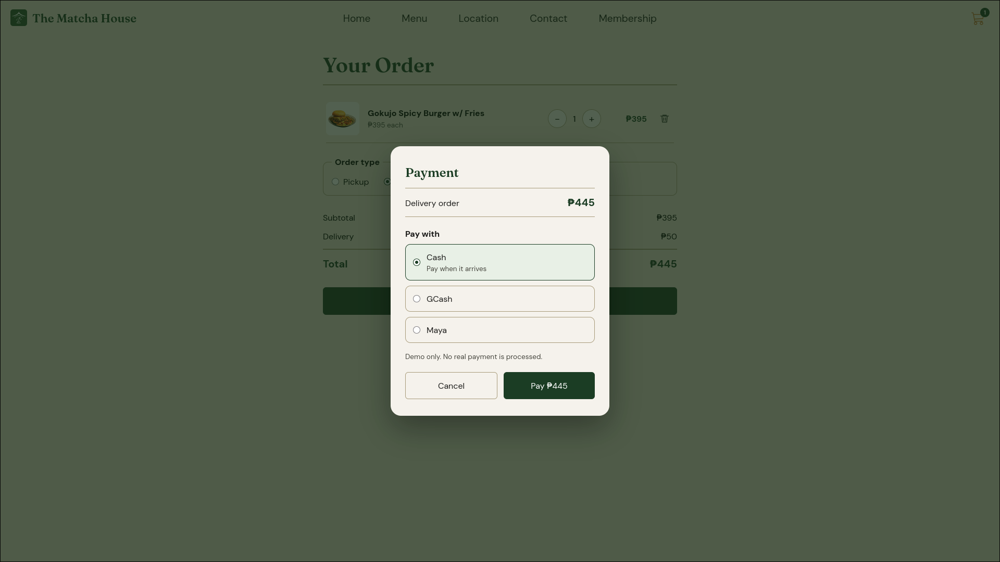

> *Figure 12. Payment dialog.*

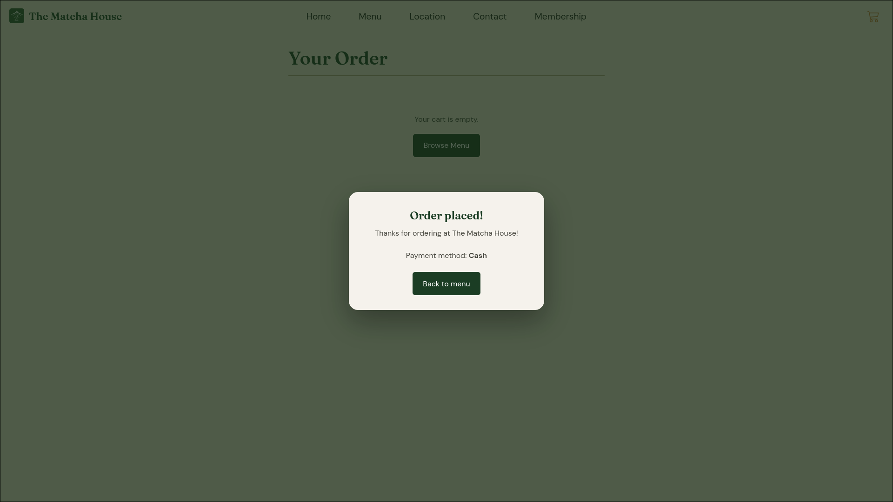

> *Figure 13. Order placed confirmation.*

### 3.7 Membership Application

**What it does.** The Membership page presents the benefits (5% discount, points and rewards, free birthday drink) and an application form with Full Name, Email Address, Phone Number, Birthday, and a consent checkbox. All fields are required, and the browser checks the email format. On submit, the script trims and checks the name and email, generates a random member ID such as TMH-123456, saves the member data in `sessionStorage`, and opens a Welcome dialog showing the name and ID. Once a member exists in the session, the cart automatically subtracts 5% from the subtotal.

**How it is used.** Fill in the form and click Submit Application. Show the confirmation at the café to claim the welcome perk. Open the cart to see the Membership Discount line.

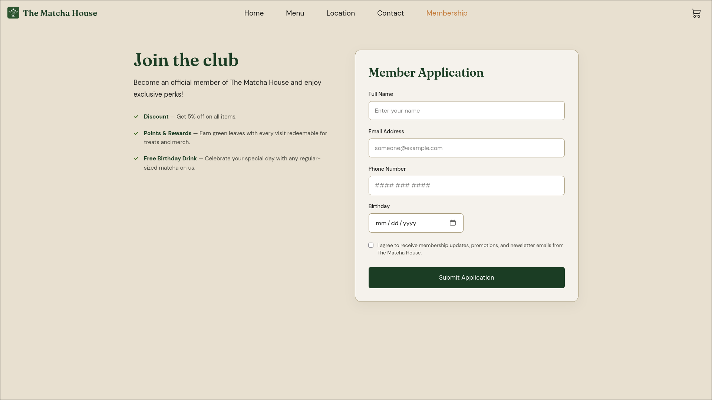

> *Figure 14. Membership page and application form.*

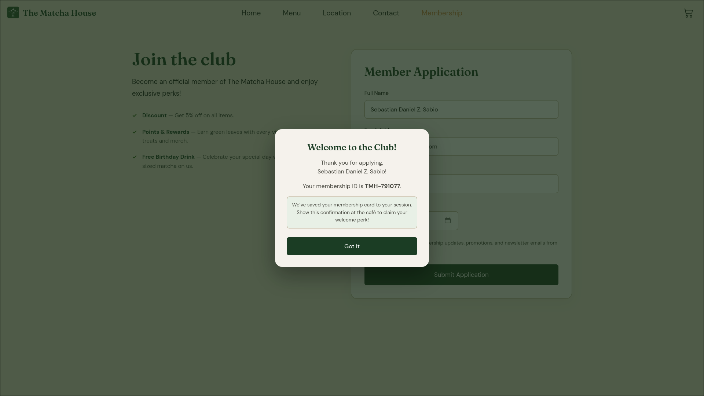

> *Figure 15. Membership confirmation with member ID.*

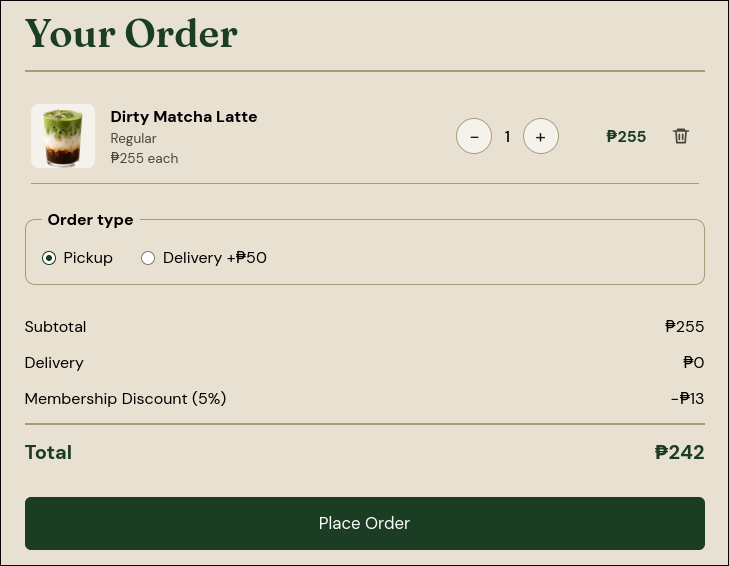

> *Figure 16. Membership discount applied in the cart.*

### 3.8 Location Page

**What it does.** The Location page shows the address, a status line with the current Philippine time (Asia/Manila), a Get directions button that opens Google Maps in a new tab, a Copy address button, a storefront photo, and an embedded Google Map. On desktop the map stays in view while scrolling; on smaller screens it stacks below the information.

**How it is used.** Click Get directions to open navigation, or Copy address to copy the address to the clipboard. A toast confirms the copy or reports a failure.

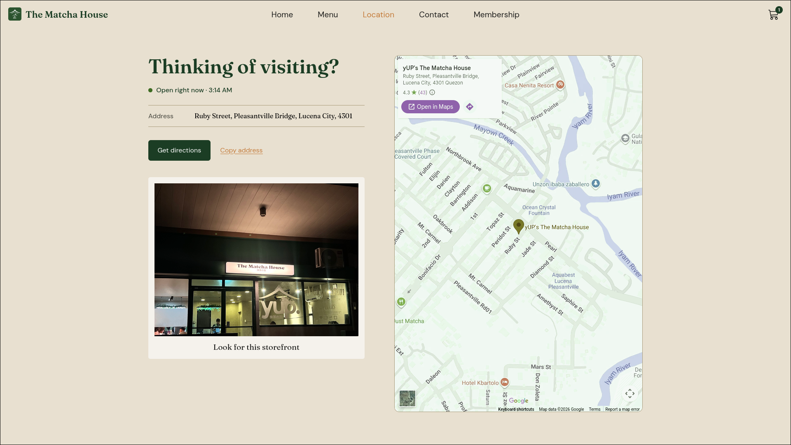

> *Figure 17. Location page with map and storefront photo.*

### 3.9 Contact Page

**What it does.** The Contact page lists the café's Facebook, Instagram, TikTok, and email links with icons, a Send an email button that opens the visitor's mail app, and an embedded Instagram feed.

**How it is used.** Click any link to open the social media page or compose an email.

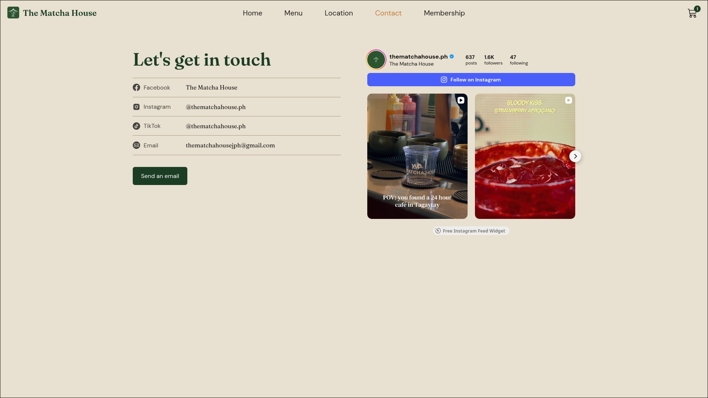

> *Figure 18. Contact page with social links and Instagram feed.*

### 3.10 Accessibility, Usability, and Feedback

Buttons and links have hover and keyboard-focus styles; interactive controls have ARIA labels; modals use the native HTML `dialog` element; the burger and category toggle report `aria-expanded`; the cart announces changes politely to screen readers; and animations are turned off for visitors who prefer reduced motion. Toast messages give feedback for adding items, copying the address, and submitting the membership form.

### 3.11 SEO, Link Previews, and Progressive Web App

Every public page has its own title, description, canonical URL, Open Graph, and Twitter card tags, and the site provides `robots.txt` and `sitemap.xml`. The site can be installed as an app through a web app manifest with 192 px, 512 px, and maskable icons, and a service worker generated by `vite-plugin-pwa` caches files for offline use.

### 3.12 Deployment

The site is built with Vite and published on Vercel at [thematchahouse.vercel.app](https://thematchahouse.vercel.app/). The `vercel.json` file rewrites clean URLs such as `/menu` to the matching HTML files.

---

## 4. Code Organization and Project Structure

This section summarizes the project structure and explains how the main files work together.

### 4.1 Technologies and Project Structure

**Technologies.** HTML5, CSS3, vanilla JavaScript (ES modules), Vite (development server and build), vite-plugin-pwa, vite-plugin-qrcode, Google Fonts (DM Sans and Fraunces), Elfsight widgets (Google Reviews and Instagram feed), Google Maps embed, and Vercel for hosting.

**Code style.** Four-space indentation, no semicolons in JavaScript, and section comments written as `/* ---------- Section ---------- */`.

**Project structure.**

```text
.
├── index.html                 Home page
├── sections/
│   ├── menu.html              Menu page
│   ├── cart.html              Cart and checkout page
│   ├── location.html          Location page
│   ├── contact.html           Contact page
│   └── membership.html        Membership page
├── public/                    Files copied as-is (videos, icons, robots.txt, sitemap.xml)
├── src/
│   ├── assets/                Images and icons
│   ├── data/menu.js           Menu data (categories and items)
│   ├── reset.css              CSS reset
│   ├── style.css              Shared styles (variables, header, buttons, toast)
│   ├── index.css  menu.css  cart.css  location.css  contact.css  membership.css
│   ├── script.js              Shared script (nav, cart button and badge)
│   ├── cart.js                Cart store (state, totals, discount)
│   ├── toast.js               Toast notifications
│   ├── index.js  menu.js  cart-page.js  location.js  membership.js
├── package.json
├── vite.config.js
├── vercel.json
└── README.md
```

**How the files work together.** Each HTML page links the shared files `reset.css`, `style.css`, and `script.js`, plus its own stylesheet and script. `cart.js` is the single source of truth for the cart and is imported by the menu, cart, and shared scripts, so the cart stays consistent on every page. `toast.js` is imported wherever feedback is shown. The menu page does not contain hard-coded items; `menu.js` builds them from `data/menu.js`.
